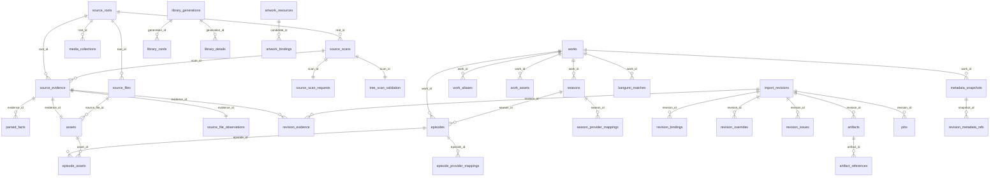

# V4 数据模型（SQLite 权威结构）

> 适用范围：现有系统的事实快照；不作为 3.0 的页面、组件、视觉或架构约束。源码及用户最新指令优先。

> 记录日期：2026-10-14
> 事实来源：backend/app/media_v4/persistence/schema_v4.py、backend/app/media_v4/persistence/database.py、backend/app/media_v4/projection/、backend/app/api/library_v4.py、backend/app/api/playback_v4.py、backend/tests/test_v4_schema_contract.py、backend/tests/test_v4_immutable_facts.py
> 定位：说明 KumiPlayer 后端 V4 SQLite 的实际表结构、迁移机制、不可变性边界与前端读模型合同字段。不回答进度条/播放器行为（见 playback-flow.md），不回答导入识别流程（见 media-pipeline.md）。

## 1. 唯一版本常量与迁移机制

| 项目 | 实际值 / 行为 | 证据 |
| --- | --- | --- |
| 唯一版本常量 | `V4_SCHEMA_VERSION = 27` | `backend/app/media_v4/persistence/schema_v4.py:11` |
| 常量引用方式 | `V4Database.CURRENT_SCHEMA_VERSION = V4_SCHEMA_VERSION`（不另写固定值） | `backend/app/media_v4/persistence/database.py:57` || 版本落点 | `PRAGMA user_version`，由 `_set_user_version` 写入并立即读回校验 | `database.py:160`、`database.py:167` |
| 版本号唯一性约束 | 测试要求整个 app 内 `V4_SCHEMA_VERSION =` 只出现一次，且 `PRAGMA user_version = {常量}` 字面量与之完全一致 | `backend/tests/test_v4_schema_version_source.py` |

初始化（`V4Database.initialize`，`database.py:195`）的四条分支：

1. `user_version > CURRENT_SCHEMA_VERSION` → 抛 `RuntimeError`，要求升级程序（`database.py:224`）。
2. 库已有用户表且版本等于当前值 → 只做物理合同校验与来源活动性对账，不改结构（`database.py:229`）。
3. 库有表但版本不在迁移表内（旧后端架构）→ 抛 `V4ResetRequiredError`，只允许一次性重置（`database.py:233`、`database.py:50`）。
4. 空库 → 调用唯一建库入口 `create_schema_v4(conn)`（`database.py:245`、`schema_v4.py:14`）；已有库逐版执行 `migrations` 字典中的迁移函数（`database.py:197`）。

结构完整性用 logical contract 校验，不逐字比较 DDL 文本：`REQUIRED_TABLES`（54 张表，`database.py:60`）与 `REQUIRED_TRIGGERS`（17 个触发器，`database.py:118`）必须齐全，且与 `create_schema_v4` 在内存库生成的列/默认值/外键/索引/触发器合同逐项一致，否则 `V4ResetRequiredError`（`database.py:293`）。迁移失败整体回滚，且迁移前后都做 `PRAGMA foreign_key_check`（`database.py:246`）。

关键纪律：**空库创建路径只允许调用 `create_schema_v4`**，新增结构必须同时进入该函数，否则会出现"版本号已是当前值但新库缺表/缺索引"（`schema_v4.py:798` 的注释即记录该历史缺陷）。`database.py:293` 的期望库同样使用 `create_schema_v4`，不再多调 helper 掩盖空库遗漏。

状态：已实现。

## 2. 表清单总览

54 张受管表（`database.py:60`）。按职能分组：

| 分组 | 表 |
| --- | --- |
| 版本与来源登记 | `v4_meta`、`source_roots`、`source_health`、`openlist_telemetry` |
| 扫描与观察事实 | `source_scans`、`source_scan_requests`、`source_scan_directories`、`tree_scan_validation`、`source_evidence`、`source_files`、`source_file_observations` |
| 解析事实 | `parsed_facts` |
| 媒体图 | `works`、`work_aliases`、`work_source_bindings`、`provider_bindings`、`work_relations`、`seasons`、`season_provider_mappings`、`episodes`、`episode_provider_mappings`、`editions`、`assets`、`episode_assets`、`work_assets`、`media_collections` |
| revision（草稿/确认） | `import_revisions`、`revision_evidence`、`revision_bindings`、`revision_issues`、`revision_overrides`、`revision_work_candidates`、`revision_collection_members` |
| 刮削与资料快照 | `scrape_bindings`、`metadata_snapshots`、`revision_metadata_refs` |
| 执行与产物 | `jobs`、`artifacts`、`artifact_references`、`maintenance_operations`、`maintenance_operation_items` |
| 图片 | `artwork_resources`、`artwork_bindings`、`artwork_variants` |
| 媒体库投影 | `library_generations`、`library_cards`、`library_details`、`library_changes` |
| 用户数据 | `work_overrides`、`tracking_states`、`playback_progress`、`playback_history` |
| Bangumi | `bangumi_matches`、`bangumi_episode_sync` |

## 3. 逐表说明

### 3.1 版本与来源登记

| 表 | 用途 | 关键字段 | 键与约束 | 证据 |
| --- | --- | --- | --- | --- |
| `v4_meta` | 键值元数据（投影代次、脏标记、调度游标、presentation policy 版本） | `key`、`value` | PK `key`；建库时写入 `schema=v4`、`backend_data_epoch=4` | `schema_v4.py:23`、`schema_v4.py:791` |
| `source_roots` | 一条来源登记：本地目录 / TXT 快照 / TXT+OpenList / OpenList 全量 | `root_id`、`provider`、`ingest_method`、`source_locator`、`playback_locator`、`route_id`、`source_mode`、`last_scan_mode`、`root_container`、`content_scope`、`enabled`、`retired_at`、`retired_reason` | PK `root_id`；`content_scope` 受 CHECK 限 `''/completed/ongoing`（v25 加列） | `schema_v4.py:57`、`schema_v4.py:770`、`schema_v4.py:895` |
| `source_health` | 来源健康状态与连续失败计数 | `source_id`、`state`、`consecutive_failures`、`cooldown_until` | PK `source_id`；索引 `idx_v4_source_health_state` | `schema_v4.py:31` |
| `openlist_telemetry` | OpenList 调用按连接/日/操作计量 | `conn_hash`、`day`、`operation`、`count` | PK 三元组 | `schema_v4.py:46` |

### 3.2 扫描与观察事实

| 表 | 用途 | 关键字段 | 键与约束 | 证据 |
| --- | --- | --- | --- | --- |
| `source_scans` | 一次来源扫描的可恢复进度 | `scan_id`、`root_id`、`generation`、`status`、`stage`、`processed_count`、`total_count`、`heartbeat_at`、`cancel_requested`、`coverage_json` | PK `scan_id`；FK→`source_roots` CASCADE；`UNIQUE(root_id, generation)` | `schema_v4.py:77`、`schema_v4.py:903` |
| `source_scan_requests` | 扫描的可序列化请求（重建 adapter 的非敏感参数 + TXT 归档引用） | `scan_id`、`scan_kind`、`source_mode`、`request_json`、`input_archive_path`、`input_sha256`、`attempts`、`retry_of`、`resume_after`、`budget_cooldowns` | PK `scan_id`；FK→`source_scans` CASCADE；凭据不入库 | `schema_v4.py:1341`、`schema_v4.py:903` |
| `source_scan_directories` | OpenList 扫描目录级 frontier（断点续扫） | `scan_id`、`remote_path`、`depth`、`status`、`next_page` | PK `(scan_id, remote_path)`；索引 `idx_source_scan_directories_pending` | `schema_v4.py:1388` |
| `tree_scan_validation` | 目录树播放根验证事实 | `scan_id`、`root_id`、`effective_root`、`ok`、`hits`、`total`、`samples_json`、`candidates_json` | PK `scan_id`；FK→`source_scans` CASCADE | `schema_v4.py:690` |
| `source_evidence` | 一条来源观察（不可变事实） | `evidence_id`、`scan_id`、`root_id`、`source_key`、`relative_path`、`entry_kind`、`size`、`mtime`、`fingerprint`、`raw_file_id`、`source_locator`、`playback_locator`、`import_family`、`presence_state`、`observation_kind`、`parent_evidence_id` | PK `evidence_id`；FK→`source_scans`/`source_roots` CASCADE；`UNIQUE(scan_id, source_key)`；**UPDATE/DELETE 触发器拒绝** | `schema_v4.py:96`、`schema_v4.py:536`、`schema_v4.py:903` |
| `source_files` | 跨扫描稳定的来源文件槽位身份 | `source_file_id`、`root_id`、`origin_evidence_id`、`identity_kind`、`identity_namespace` | PK；FK→`source_roots`/`source_evidence` RESTRICT；`UNIQUE(root_id, origin_evidence_id)` | `schema_v4.py:1582` |
| `source_file_observations` | 观察→槽位→Asset 的决策关联（不可变） | `evidence_id`、`source_file_id`、`asset_id`、`decision_json` | PK `evidence_id`；**UPDATE 触发器拒绝** | `schema_v4.py:1595`、`schema_v4.py:1708` |

### 3.3 解析事实

| 表 | 用途 | 关键字段 | 键与约束 | 证据 |
| --- | --- | --- | --- | --- |
| `parsed_facts` | 单文件解析结果（不可变事实） | `parsed_fact_id`、`evidence_id`、`parser_version`、`resource_type`、`media_type`、`group_type`、`work_title`、`title_candidates_json`、`season_candidate`、`episode_candidate`、`absolute_episode_candidate`、`special_candidate`、`special_number`、`episode_title`、`edition_tags_json`、`quality_tags_json`、`confidence`、`needs_review`、`is_importable`、`is_auxiliary`、`content_class`、`classification_state`、`decision_trace_json`、`numbering_json` | PK `parsed_fact_id`；FK→`source_evidence` CASCADE；**UPDATE/DELETE 触发器拒绝**；索引 `idx_v4_facts_evidence` | `schema_v4.py:124`、`schema_v4.py:554`、`schema_v4.py:777` |

解析器版本常量：`V4Parser.VERSION = "v4-parser-18"`（`backend/app/media_v4/parsing/parser.py:351`）。

### 3.4 媒体图

| 表 | 用途 | 关键字段 | 键与约束 | 证据 |
| --- | --- | --- | --- | --- |
| `works` | 作品 | `work_id`、`identity_key`、`work_type`、`preferred_title`、`original_title`、`year`、`status`、`show_type`、`card_type` | PK `work_id`；`UNIQUE identity_key`；`show_type`/`card_type` 为 v6 加列 | `schema_v4.py:168`、`schema_v4.py:771` |
| `work_aliases` | 作品别名（多语言） | `work_id`、`normalized_title`、`language`、`alias_type` | PK 三元组；FK→`works` CASCADE | `schema_v4.py:193` |
| `work_source_bindings` | 作品↔来源结构边界绑定 | `work_id`、`root_id`、`structural_key`、`confidence`、`binding_source` | PK 三元组；索引 `idx_v4_source_bindings_lookup` | `schema_v4.py:204` |
| `provider_bindings` | 作品↔在线资料身份（v21 起可多作品共享同一 provider id） | `work_id`、`provider`、`media_type`、`provider_id` | PK `(work_id, provider, media_type)`；反查索引 `idx_v4_provider_bindings_identity` | `schema_v4.py:216`、`schema_v4.py:1471` |
| `work_relations` | 作品父子/关联关系 | `parent_work_id`、`child_work_id`、`relation_type` | PK `relation_id`；FK→`works` CASCADE；`UNIQUE(parent, child, type)` | `schema_v4.py:706` |
| `seasons` | 季；`local_season_number` 可为 NULL（未分季） | `season_id`、`work_id`、`local_season_number`、`season_kind`、`title`、`identity_key` | PK；FK→`works` CASCADE；`UNIQUE(work_id, local_season_number, season_kind)`；`uq_v4_seasons_identity` 与两条 `v4_season_identity_kind_guard_*` 触发器 | `schema_v4.py:231`、`schema_v4.py:1665`、`schema_v4.py:1730` |
| `season_provider_mappings` | 本地季↔在线季号 | `season_id`、`provider`、`provider_season_number`、`provider_season_id` | PK `(season_id, provider)` | `schema_v4.py:244` |
| `episodes` | 集 | `episode_id`、`work_id`、`season_id`、`local_episode_number`、`absolute_episode_number`、`special_number`、`episode_kind`、`display_title`、`identity_key` | PK；FK→`works`/`seasons` CASCADE；坐标唯一索引 `uq_v4_episode_local_identity` 仅约束 `identity_key=''` 的 legacy 行（v23） | `schema_v4.py:255`、`schema_v4.py:925` |
| `episode_provider_mappings` | 本地集↔在线集号 | `episode_id`、`provider`、`provider_season_number`、`provider_episode_number`、`provider_episode_id` | PK `(episode_id, provider)` | `schema_v4.py:270` |
| `editions` | 版本（导演剪辑/加长等），挂在 Episode 或 Work 之一 | `edition_id`、`episode_id`、`work_id`、`edition_key`、`display_name`、`duration_hint`、`evidence_json` | CHECK 保证 episode/work 二者互斥单一；`UNIQUE(episode_id, edition_key)`、`UNIQUE(work_id, edition_key)` | `schema_v4.py:282` |
| `assets` | 可播放文件资产 | `asset_id`、`evidence_id`、`root_id`、`source_locator`、`playback_locator`、`fingerprint`、`size`、`mtime`、`resolution`、`video_codec`、`audio_codec`、`release_group`、`version_tags_json`、`availability_state`、`source_file_id`、`content_version_key` | PK；FK→`source_evidence`/`source_roots` CASCADE、`source_files` RESTRICT；`UNIQUE(evidence_id)`；`uq_v4_assets_source_version` 唯一化同槽位同内容版本 | `schema_v4.py:298`、`schema_v4.py:1673` |
| `episode_assets` | 集↔资产（含角色与偏好序） | `episode_id`、`edition_id`、`asset_id`、`role`、`preference_rank` | PK `(episode_id, asset_id)` | `schema_v4.py:321` |
| `work_assets` | 电影等作品级资产 | `work_id`、`edition_id`、`asset_id`、`role`、`preference_rank` | PK `(work_id, asset_id)` | `schema_v4.py:333` |
| `media_collections` | 非媒体合集容器（v26） | `collection_id`、`collection_key`、`preferred_title`、`root_id`、`parent_collection_id` | PK；FK→`source_roots`；`UNIQUE collection_key` | `schema_v4.py:878` |

### 3.5 revision（草稿 → 确认）

| 表 | 用途 | 关键字段 | 键与约束 | 证据 |
| --- | --- | --- | --- | --- |
| `import_revisions` | 一次解析结果的固化与状态机 | `revision_id`、`root_id`、`scan_id`、`resolver_version`、`status`、`graph_digest`、`created_at`、`confirmed_at` | PK；`status` CHECK ∈ draft/confirmed/executing/completed/failed/superseded；`uq_v4_active_revision_per_root` 保证每 root 仅一条 confirmed | `schema_v4.py:345`、`schema_v4.py:774` |
| `revision_evidence` | revision 引用的证据与解析事实 | `revision_id`、`evidence_id`、`parsed_fact_id` | PK `(revision_id, evidence_id)`；FK RESTRICT；confirmed 后 **UPDATE/DELETE 触发器拒绝** | `schema_v4.py:360`、`schema_v4.py:598` |
| `revision_bindings` | confirmed 媒体图的绑定行（作品/季/集/版本/资产） | `binding_id`、`revision_id`、`evidence_id`、`work_id`、`season_id`、`episode_id`、`edition_id`、`asset_id`、`confidence`、`decision_source`、`reasons_json`、`override_json`、`resolved_json` | PK；`UNIQUE(revision_id, evidence_id, episode_id, edition_id, asset_id)`；confirmed 后 **UPDATE/DELETE 触发器拒绝**；索引 `idx_v4_bindings_revision`、`idx_v4_bindings_work` | `schema_v4.py:370`、`schema_v4.py:572`、`schema_v4.py:1427` |
| `revision_issues` | 未决 review 问题（阻断确认） | `revision_id`、`issue_id`、`code`、`evidence_id`、`message`、`resolved` | PK `(revision_id, issue_id)` | `schema_v4.py:390` |
| `revision_overrides` | 确认前的逐证据人工修正 | `revision_id`、`evidence_id`、`overrides_json`、`created_at` | PK `(revision_id, evidence_id)`；**仅 draft 可写**（INSERT/UPDATE/DELETE 三条触发器） | `schema_v4.py:403`、`schema_v4.py:624` |
| `revision_work_candidates` | 确认前持久化的在线候选 | `candidate_id`、`revision_id`、`work_id`、`draft_work_key`、`provider`、`provider_id`、`title`、`aliases_json`、`year`、`score`、`reasons_json`、`popularity`、`recommended`、`status` | PK `candidate_id`；索引无强制唯一 | `schema_v4.py:717`、`schema_v4.py:1364` |
| `revision_collection_members` | revision 确认的合集成员（v26） | `revision_id`、`collection_id`、`work_id` | PK 三元组；全部 FK CASCADE；索引 `idx_collection_members_work` | `schema_v4.py:886` |

`import_revisions` 另有 `v4_confirmed_revision_snapshot_guard` 与 `v4_confirmed_revision_delete_guard`：confirmed/superseded 快照字段不可改，且非 draft 行不可删除（`schema_v4.py:663`、`schema_v4.py:679`）。

### 3.6 刮削与资料快照

| 表 | 用途 | 关键字段 | 键与约束 | 证据 |
| --- | --- | --- | --- | --- |
| `scrape_bindings` | 作品↔在线资料绑定与状态 | `binding_id`、`revision_id`、`work_id`、`provider`、`provider_id`、`metadata_json`、`status`、`created_at`、`updated_at` | PK；FK→`import_revisions`/`works` CASCADE；`UNIQUE(revision_id, work_id, provider)` | `schema_v4.py:414` |
| `metadata_snapshots` | 不可变资料快照（成功代次） | `snapshot_id`、`work_id`、`provider`、`media_type`、`provider_id`、`identity_signature`、`metadata_json`、`episode_signatures_json`、`created_by_revision_id` | PK；FK RESTRICT；**UPDATE 触发器拒绝**；索引 `idx_v4_metadata_snapshots_identity` | `schema_v4.py:1606`、`schema_v4.py:1717` |
| `revision_metadata_refs` | revision↔作品↔快照引用 | `revision_id`、`work_id`、`snapshot_id`、`created_at` | PK `(revision_id, work_id)` | `schema_v4.py:1622` |

### 3.7 执行与产物

| 表 | 用途 | 关键字段 | 键与约束 | 证据 |
| --- | --- | --- | --- | --- |
| `jobs` | V4 outbox 任务 | `job_id`、`job_type`、`revision_id`、`work_id`、`idempotency_key`、`status`、`attempts`、`last_error`、`cancel_requested`、`heartbeat_at`、`started_at`、`finished_at`、`result_json` | PK；`status` CHECK ∈ queued/running/succeeded/failed/cancelled；`UNIQUE idempotency_key`；索引 `idx_v4_jobs_status`、`idx_v4_jobs_revision` | `schema_v4.py:430`、`schema_v4.py:1435` |
| `artifacts` | 生成物登记（NFO 等） | `artifact_id`、`revision_id`、`work_id`、`artifact_type`、`target_path`、`digest`、`status` | PK；FK CASCADE；`UNIQUE(revision_id, artifact_type, target_path)`；索引 `idx_v4_artifacts_work` | `schema_v4.py:452`、`schema_v4.py:1431` |
| `artifact_references` | 产物→revision/work/snapshot 引用 | `reference_id`、`artifact_id`、`revision_id`、`work_id`、`snapshot_id`、`role`、`subject_id` | PK；FK RESTRICT；`UNIQUE(artifact_id, revision_id, role, subject_id)` | `schema_v4.py:1633` |
| `maintenance_operations` | 媒体库维护操作（清理等） | `operation_id`、`scope_provider`、`status`、`preview_json`、`result_json`、`digest`、`root_ids_json`、`mirror_root_identity`、`expires_at` | PK | `schema_v4.py:739`、`schema_v4.py:1172` |
| `maintenance_operation_items` | 维护操作逐项明细 | `item_id`、`operation_id`、`artifact_id`、`root_id`、`revision_id`、`target_path`、`plan_status`、`result_status` | PK；FK→`maintenance_operations` CASCADE；`ux_maintenance_op_artifact` 唯一 | `schema_v4.py:756`、`schema_v4.py:1207` |

### 3.8 图片

| 表 | 用途 | 关键字段 | 键与约束 | 证据 |
| --- | --- | --- | --- | --- |
| `artwork_resources` | 单个图片下载/编码资源（含租约与重试） | `resource_id`、`source_url`、`local_source`、`content_digest`、`original_path`、`state`、`attempts`、`retry_at`、`lease_until`、`lease_token`、`error_kind` | PK；`state` CHECK ∈ pending/running/retry/ready/failed/cancelled；索引 `idx_artwork_resources_queue` | `schema_v4.py:814` |
| `artwork_bindings` | 主体（work/episode/metadata）×角色 → 候选/已发布/自动资源 | `subject_type`、`subject_id`、`work_id`、`role`、`candidate_id`、`published_id`、`automatic_id`、`priority`、`revision_id`、`snapshot_id`、`member_signature` | PK `(subject_type, subject_id, role)`；subject_type CHECK ∈ work/episode/metadata；role CHECK ∈ poster/fanart/clearlogo/episode_thumb/profile/related_poster | `schema_v4.py:831` |
| `artwork_variants` | 派生尺寸缓存 | `content_digest`、`recipe_version`、`width`、`relative_path`、`pixel_width`、`pixel_height`、`byte_size`、`etag` | PK `(content_digest, recipe_version, width)` | `schema_v4.py:850` |

派生尺寸合同：`RECIPE_VERSION = 'webp-v1'`，角色宽度表 `ROLE_WIDTHS`（poster 256/384/512、fanart 512/768/1280、episode_thumb 384/768 等，`backend/app/media_v4/assets/catalog.py:17`、`catalog.py:18`）。

### 3.9 媒体库投影

| 表 | 用途 | 关键字段 | 键与约束 | 证据 |
| --- | --- | --- | --- | --- |
| `library_generations` | 投影代次 | `generation_id`、`digest`、`status`、`created_at`、`published_at` | PK | `schema_v4.py:468` |
| `library_cards` | 发布卡片 | `generation_id`、`work_id`、`title`、`year`、`media_type`、`episode_count`、`asset_count`、`metadata_json` | PK `(generation_id, work_id)`；FK→`library_generations` CASCADE | `schema_v4.py:479` |
| `library_details` | 发布详情 JSON（v27） | `generation_id`、`work_id`、`detail_json` | PK `(generation_id, work_id)`；FK CASCADE | `schema_v4.py:868` |
| `library_changes` | 展示变更日志（自增序号） | `sequence`、`kind`、`work_id`、`created_at` | PK `sequence`（AUTOINCREMENT）；kind ∈ work_upsert/work_remove/artwork/watch/reset；索引 `idx_library_changes_work` | `schema_v4.py:861`、`backend/app/media_v4/projection/changes.py:12` |

投影只在发布事务中重建，读请求读同一读事务快照（`backend/app/media_v4/projection/library.py:114`、`library.py:222`）。

### 3.10 用户数据

| 表 | 用途 | 关键字段 | 键与约束 | 证据 |
| --- | --- | --- | --- | --- |
| `work_overrides` | 作品用户覆盖层（标题、图片、隐藏、详情标签） | `work_id`、`override_json`、`created_at`、`updated_at` | PK `work_id` | `schema_v4.py:183` |
| `tracking_states` | 观看状态/收藏/笔记（provider 维度） | `work_id`、`provider`、`provider_id`、`last_watched_episode`、`metadata_json`、`updated_at` | PK `(work_id, provider)` | `schema_v4.py:523` |
| `playback_progress` | 按 (episode, asset) 的续播位置 | `episode_id`、`asset_id`、`work_id`、`position`、`duration`、`completed`、`updated_at` | PK `(episode_id, asset_id)` | `schema_v4.py:494` |
| `playback_history` | 播放事件（含当时标题/季集快照） | `event_id`、`work_id`、`episode_id`、`asset_id`、`played_at`、`title_snapshot`、`season_snapshot`、`episode_snapshot`、`source_provider` | PK `event_id` | `schema_v4.py:508` |

### 3.11 Bangumi

| 表 | 用途 | 键与约束 | 证据 |
| --- | --- | --- | --- |
| `bangumi_matches` | 作品/季↔Bangumi 条目映射 | PK `(work_id, season_number)`；FK→`works` CASCADE；索引 `idx_bangumi_matches_subject` | `schema_v4.py:1233` |
| `bangumi_episode_sync` | 逐集同步结果 | PK `(episode_id, subject_id)`；FK→`episodes` CASCADE | `schema_v4.py:1248` |

## 4. 实体关系（外键对应）

说明：图中所示均为源码中的真实 `REFERENCES`。用户数据表（`playback_progress`、`playback_history`、`tracking_states`）刻意不对 `works`/`episodes` 建外键，避免清理或重扫媒体图时被用户数据反向阻断。

## 5. 数据分类：不可变事实 / 可重建投影 / 用户数据

| 分类 | 表 | 保护机制 | 证据 |
| --- | --- | --- | --- |
| 不可变事实 | `source_evidence`、`parsed_facts`、`source_file_observations`、`metadata_snapshots` | 表级 UPDATE/DELETE 触发器一律 ABORT | `schema_v4.py:536`、`schema_v4.py:554`、`schema_v4.py:1708`、`schema_v4.py:1717` |
| 不可变事实（条件） | `revision_evidence`、`revision_bindings`、`revision_overrides`、`import_revisions` 快照字段 | 仅当 revision 状态非 draft 时拒绝改/删；draft 期间可编辑 | `schema_v4.py:572`、`schema_v4.py:598`、`schema_v4.py:624`、`schema_v4.py:663` |
| 当前媒体图 | `works`、`seasons`、`episodes`、`editions`、`assets`、`episode_assets`、`work_assets`、`provider_bindings`、`work_aliases` | 可增量更新/合并，但只能由确认事务派生 | media-pipeline.md |
| 可重建投影（可丢弃） | `library_generations`、`library_cards`、`library_details`、`library_changes` | 重建时 `DELETE FROM library_generations WHERE generation_id != ?` 级联清理；现场测试 `test_v4_library_projection.py` | `library.py:454` |
| 可重建加速数据 | `source_scan_directories`、`tree_scan_validation`、`source_health` 的冷却、`v4_meta` 中 dirty/游标类键 | 丢失后可用完整扫描或重建恢复 | media-pipeline.md |
| 用户数据（不可由识别链改写） | `work_overrides`、`tracking_states`、`playback_progress`、`playback_history`、`bangumi_matches`、`bangumi_episode_sync` | 只由用户操作/播放写入（如 `V4TrackingStore.save_state`、`V4PlaybackStore.save_progress`）；投影读取但从不回写媒体事实 | `backend/app/media_v4/tracking/store.py:16`、`backend/app/media_v4/playback/store.py:28` |

`work_overrides.override_json` 实际承载的键（从源码读取，非枚举所有可能）：`title`、`hidden`、`local_poster_path`、`local_fanart_path`、`local_clearlogo_path`、`detail_tags`（`backend/app/media_v4/projection/presentation.py:26`、`backend/app/api/library_v4.py:81`、`backend/app/api/work_customization_v4.py:50`、`backend/app/media_v4/projection/details.py:260`）。

## 6. 前端展示合同字段

### 6.1 媒体库卡片合同

`/api/library` 返回的每张卡片由 `_card_payload` 组装（`backend/app/api/library_v4.py:59`）。持久列只有 `work_id`、`title`、`year`、`media_type`、`episode_count`、`asset_count`，其余来自 `metadata_json` 内的白名单字段（`library.py:22` 的 `COMPACT_METADATA_FIELDS`）。

| 字段 | 含义 / 来源 | 证据 |
| --- | --- | --- |
| `work_id` | 作品 ID | `library_v4.py:84` |
| `title` | 展示标题：用户覆盖 > 刮削/本地（依 `preserve_identity_title`） | `library_v4.py:85`、`presentation.py:26` |
| `original_title`、`year`、`rating`、`plot`、`genres`、`studios` | 刮削资料（缺省为空） | `library_v4.py:86` |
| `title_provenance` | `manual` / `online` / `local` | `library_v4.py:88` |
| `media_type` | `tv` / `movie` / `unknown`；由 `works.work_type` 映射 | `library.py:278` |
| `show_type`、`card_type` | 以后端持久化 `works` 列为准，缺失才回退默认 | `library_v4.py:64` |
| `episode_count` / `asset_count` | 由 confirmed 可见绑定去重统计 | `library.py:299`、`library.py:307` |
| `season_count`、`special_season_count`、`latest_episode_number` | 季/集统计 | `library_v4.py:103`、`library.py:383` |
| `sources` / `source` | confirmed 证据的 provider 集合 | `library.py:322` |
| `poster_path`、`fanart_path`、`clearlogo_path` 及 `local_*` 变体 | 已发布 artwork variant 的相对 URL | `library_v4.py:107` |
| `watch_status` | 来自 `tracking_states` 的 `{status, note, favorite, updated_at}` | `library_v4.py:289` |
| `content_scope` | `ongoing` / `completed` / 空 | `library_v4.py:207` |
| `collections`、`related_works` | 合集与关联作品 | `library.py:369`、`collections.py:69` |
| `metadata_state` | `ready` / `waiting_metadata` / `waiting_review` / `source_unavailable` / `failed` / `not_required` | `library.py:398` |

发布门槛：`metadata_state == 'ready'` 且 `required_artwork_status(...)['status'] == 'ready'` 才进入 `library_cards`（`library.py:428`、`assets/status.py:6`）。列表接口另有 `change_sequence`、`generation_id`、`updating`、`background_active`、`digest`（`library_v4.py:221`）。

### 6.2 详情合同

`/api/library/works/{work_id}` 直接读发布好的 `library_details.detail_json` 再补已发布图片（`backend/app/api/library_v4.py:260`）。`detail_json` 由 `build_work_detail` 生成（`backend/app/media_v4/projection/details.py:52`），字段：

| 字段 | 含义 | 证据 |
| --- | --- | --- |
| `work_id`、`title`、`original_title`、`year`、`rating`、`plot`、`genres`、`studios` | 作品资料 | `details.py:271` |
| `title_provenance` | `manual` / `online` / `local` | `details.py:275` |
| `media_type`、`show_type`、`card_type`、`content_scope` | 类型与分类 | `details.py:281` |
| `seasons[]` | `season_id`、`season_number`、`group_type`、`label`、`episode_count`、`episodes[]` | `details.py:243` |
| `episodes[]` | `episode_id`、`season_number`、`season_id`、`season_kind`、`numbering_status`、`episode_number`、`absolute_episode_number`、`special_number`、`title`、`original_filename`、`runtime`、`thumb_path`、`group_type`、`kind`、`playback_locator`、`asset_id`、`source`、`availability`、`assets[]` | `details.py:158` 起 |
| `episode_count`、`asset_count` | 详情内统计 | `details.py:289`、`details.py:290` |
| `source_locations` | provider → 源定位符集合 | `details.py:291` |
| `poster_path`、`fanart_path`、`local_*`、`clearlogo_path` | 图片 | `details.py:292` |
| `related_works`、`collections`、`cast`、`tags`、`certification` | 关联与演职员 | `details.py:299` |
| `metadata_state`、`metadata_source`、`metadata_snapshot_id`、`refresh_status`、`episode_mapping_status`、`mapped_count`、`total_count` | 资料状态 | `details.py:306` |
| `watch_status` | `{work_id, status, note, favorite, updated_at}` | `details.py:315` |

判别式注意：`episodes[].assets[]` 每项为 `{asset_id, playback_locator, availability, source}`（`details.py:198`），详情页据此选可播放资产；电影的作品级资产被折叠为一条 `episode_id = "movie:<work_id>"` 的伪集（`details.py:226`）。

## 7. 未确认项

- 未确认：`v4_meta` 的完整键集合没有集中定义或 schema 约束，键名散落在各模块（如 `artwork_manual_adoption_cursor` 在 `assets/service.py:181`、`ongoing_calendar_slot` 在 `tracking/scheduler.py`）。无法从代码给出"权威键清单"，只能按调用点枚举。
- 未确认：`editions` 在真实导入链中的产生路径未在本次核对中逐行确认（表结构与约束已确认，写入方未定位）。
- 未确认：`work_source_bindings.structural_key` 的具体编码格式由 `revisions/service.py` 的 `_structural_key` 生成，本次未逐行验证其全部取值分支。
- 未确认：`source_scan_directories` 与 `tree_scan_validation` 的清理时机只在 API 层部分可见（`backend/app/api/media_v4.py:1311` 附近），未确认是否所有失败分支都会清理。
- 未确认：`bangumi_matches.episode_map_json` 与 `bangumi_episode_sync` 的一致性约束（无外键强制），需要运行时检查而非 schema 保证。
